# High-Performance Similarity Search over 20,000 Recent arXiv Abstracts

**YZM 513 – High-Performance Programming for AI · Project 1**
_Ahmet Ozan Yıldırım (269797005) · Mazhar Selvitopi (269797013)_ · _GitHub: [ahmetozanyildirim/yzm513-similarity-search](https://github.com/ahmetozanyildirim/yzm513-similarity-search)_

> **Summary.** The task: return the top-10 most similar abstracts, by cosine similarity, for each of 200 queries over 20,000
> arXiv abstracts embedded in 768 dimensions. The pure-Python baseline takes **154.4 s**. The final engine takes
> **3.89 ms (39,689x faster)**, or 0.21 ms for a single query. Its pipeline: normalise the vectors once → TruncatedSVD to
> 128 dimensions → one batched BLAS matrix product → parallel top-k of 100 candidates → exact re-rank in 768 dimensions. It
> returns the baseline's top-10 for every query at every corpus size, with scores within 7.7e-8. Three lessons:
> * **Fixes inside Python reach at most 3.8x.** The baseline is slow because of the interpreter, not the algorithm.
> * **After vectorisation, the bottleneck moved to a single-threaded top-k selection.** It took 66% of the time, and adding
>   BLAS threads could not fix it: by Amdahl's law the speed-up stops at 2.1x on 16 threads.
> * **Threads in one process beat process pools, Dask's process and distributed schedulers, and Ray.** At this size the data fits in RAM and even in the 96 MB L3
>   cache.

## 1. Introduction

### 1.1 Problem

A user submits a query and the system must return the **top-k (k = 10) most similar documents** from a corpus of
**N = 20,000** recent paper abstracts. It must be fast enough to be interactive: well below 100 ms per query. Similarity is
the cosine of 768-dimensional sentence embeddings. A straightforward pure-Python implementation needs **0.77 s per query**
(Section 2). This report follows the path from that baseline to a sub-millisecond engine, and every design choice on the way
is backed by a measurement. Every optimised version must return the **same top-10 as the baseline**, with scores within 1e-5.

### 1.2 Dataset: arXiv abstracts 2025-2026 (Option B)

We chose option B (recent academic abstracts) because it is a **realistic retrieval workload** (paper search, the retrieval
step of a RAG system), it is **free and reproducible** (public arXiv API, `scripts/prepare_data.py`), and it has a
**built-in correctness signal**: the queries are paper titles, and each paper's own abstract is the known right answer.
Options A and C would have required paid API calls or a running system; option D would have needed a justification that
synthetic data represents a real workload.

**Source.** The arXiv API, categories cs.AI, cs.CL and cs.LG, papers submitted between January 2025 and September 2026:
21 months x 3 categories = 63 (month, category) cells of 500 papers each, 31,500 records in total.

| Preprocessing step | Records left | Why |
|---|---:|---|
| Raw API records | 31,500 | |
| Remove duplicate arXiv IDs | 24,866 | A cross-listed paper appears in several cells (~21% of the records). |
| Remove identical abstracts | 24,865 | |
| Keep abstracts with >= 50 words | 24,833 | The assignment asks for >= 50 tokens on average; this drops 32 very short entries. |
| Random sample (seed 42) | **20,000** | Every prefix (first 1K, 5K, 10K) is itself a random sample, used for the scaling test. |

Whitespace is collapsed when the records are parsed. **A document is the abstract only**: the title is kept out, otherwise
searching by title would be trivial. **The 200 queries** are the titles of 200 papers drawn from the first 1,000 documents,
so the correct answer exists at every corpus size of the scaling test.

| Statistic | Value |
|---|---|
| Documents / queries | 20,000 / 200 |
| Abstract length (model tokenizer) | Mean **261** tokens, median 258, min 59, max 1,052 (mean 178 words) |
| Abstracts longer than the model's 384-token window | 3.8% (the embedding model truncates their tail) |
| Query length / dates | 10.4 words on average / 2025-01-01 to 2026-09-05 |
| Primary categories (top) | cs.CL 5,869 · cs.LG 5,212 · cs.AI 2,303 · cs.CV 1,786 · cs.CR 515 · cs.RO 416 · stat.ML 381 · cs.IR 338 |

Sample items (each query is followed by its target document; more statistics and Figure 0 are in Appendix A):

| Query (title) | Target abstract (beginning) |
|---|---|
| *Distributed Equivariant Graph Neural Networks for Large-Scale Electronic Structure Prediction* | Doc 6, cs.LG, 2025-07-04, 140 words: "Equivariant Graph Neural Networks (eGNNs) trained on density-functional theory (DFT) data can potentially perform electronic structure prediction at unprecedented scales, ..." |
| *COFFEE: COdesign Framework for Feature Enriched Embeddings in Ads-Ranking Systems* | Doc 22, cs.IR, 2026-01-06, 206 words: "Diverse and enriched data sources are essential for commercial ads-recommendation models to accurately assess user interest ..." |

**Vectors.** Every abstract and query is embedded with `sentence-transformers/all-mpnet-base-v2` (768 dimensions, float32,
unit length): the corpus matrix is 20,000 x 768 = **58.6 MB**. 768 is the upper end of the allowed range, which makes the
effect of dimensionality reduction clearly visible. As the assignment FAQ states, embedding generation is **not** part of
any benchmark; it was done once and cached (2,199 s on this CPU).

**Sanity check.** With exact cosine search over all 20,000 abstracts, the title's own abstract is ranked first for **74%**
of the queries and within the top-10 for **90%**: the embeddings are meaningful and the task is non-trivial (the misses are
mostly very generic titles, or papers with close neighbours on the same topic).

### 1.3 Hardware and software

| Component | Version / spec |
|---|---|
| CPU | AMD Ryzen 7 9800X3D: 8 physical cores / 16 threads (SMT), **96 MB L3 cache** (3D V-Cache) |
| RAM / OS | 31.2 GB / Windows 11 (10.0.26200) |
| Python | 3.12.10 (virtual environment, `requirements.txt`); free-threaded 3.14.3t for one experiment |
| Numerical stack | NumPy 2.5.4 with OpenBLAS 0.3.34 (16 threads), SciPy 1.18.1, scikit-learn 1.9.1 |
| JIT / parallel | Numba 0.68.0 (16 threads), Dask 2026.8.0, Ray 2.59.0, FAISS 1.15.1 |
| Profiling | cProfile, line_profiler 5.1.0, py-spy |

The size of the L3 cache explains several results later on: the 58.6 MB corpus fits in it, but a 10x larger corpus does not
(Section 6).

### 1.4 Benchmarking methodology

* Every timing uses **warm-up runs** (at least one; three for anything JIT-compiled) and then **at least 5 timed runs** with
  `time.perf_counter`; we report the **median** (mean, std and raw times are in `results/`).
* **No extrapolation:** every time is a direct measurement of the stated workload. The naive baseline was timed in full:
  all 200 queries at 1K, 5K, 10K and 20K documents, 1 warm-up + 5 runs each.
* **One clean run:** all phases ran once, in order, on an idle machine (70 min in total); the run log recorded no
  other busy process before any phase.
* **Correctness:** every optimised version is compared rank by rank with the stored baseline top-10, scores within **1e-5**.
* BLAS and Numba thread counts are set explicitly where a comparison needs it. One-off costs (embedding, normalisation,
  SVD fit, inverted index) are reported separately, never inside search times. Every figure and number is produced by
  `src/hpss/experiments/` (`python scripts/run_all.py`).

## 2. Baseline & Profiling

### 2.1 Naive algorithm

The baseline follows the assignment literally: pure Python, nested loops, and the cosine computed element by element
(`src/hpss/naive.py`).

```python
def cosine_similarity_python(a, b):
    dot = 0.0
    norm_a = 0.0
    norm_b = 0.0
    for i in range(len(a)):
        dot += a[i] * b[i]
        norm_a += a[i] * a[i]
        norm_b += b[i] * b[i]
    if norm_a == 0.0 or norm_b == 0.0:
        return 0.0
    return dot / (math.sqrt(norm_a) * math.sqrt(norm_b))

def search_naive(queries, corpus, k=10):
    results = []
    for query in queries:
        scores = []
        for d_idx, doc in enumerate(corpus):
            sim = cosine_similarity_python(query, doc)
            scores.append((d_idx, sim))
        scores.sort(key=lambda x: x[1], reverse=True)
        results.append(scores[:k])
    return results
```

**Code:** [`src/hpss/naive.py`](https://github.com/ahmetozanyildirim/yzm513-similarity-search/blob/master/src/hpss/naive.py) – `cosine_similarity_python` + `search_naive` ([L18–46](https://github.com/ahmetozanyildirim/yzm513-similarity-search/blob/master/src/hpss/naive.py#L18-L46)); the pure-Python fixes of §2.5: `search_python_prenorm`, `search_python_builtin` ([L53–85](https://github.com/ahmetozanyildirim/yzm513-similarity-search/blob/master/src/hpss/naive.py#L53-L85)).

For 200 queries and 20,000 documents this is 4 million calls of the cosine function. Each call runs 768 loop iterations
with three multiply-adds, which gives **9.2 billion interpreted multiply-adds**. Two thirds of them only recompute norms.

### 2.2 Baseline time

All 200 queries at every corpus size, 1 warm-up + 5 timed runs each (nothing extrapolated):

| Documents | Median (5 runs) | Std | Per query | Per query-document pair |
|---:|---:|---:|---:|---:|
| 1,000 | 7.73 s | 0.02 s | 38.6 ms | 38.6 µs |
| 5,000 | 38.62 s | 0.10 s | 193 ms | 38.6 µs |
| 10,000 | 77.59 s | 0.39 s | 388 ms | 38.8 µs |
| **20,000** | **154.36 s** | 0.07 s | **772 ms** | 38.6 µs |

**Baseline: 200 queries x 20,000 documents take 154.4 s, i.e. 0.77 s per query**, almost eight times the 100 ms
interactive budget. The time grows exactly linearly (20x the documents, 19.98x the time; cost per pair constant within
0.5%): the problem is not the complexity, O(Q·N·d), but its constant factor. `timeit` of a single cosine call gives
**38.3 ± 0.4 µs**, the same as the cost per pair, so almost all of the time is spent inside that one function.

### 2.3 Profiling

Four tools from week 1, each answering a different question:
* **`timeit`** – how much one cosine call costs (above).
* **`cProfile`** – *which function*: the full baseline workload, profiled once in a separate plain Python process
  (`scripts/profile_naive.py --cprofile`). Since Python 3.12, cProfile is built on `sys.monitoring`, which sees every thread
  of the process; inside Jupyter the kernel's own I/O threads were mixed into the profile (Section 7).
* **`line_profiler`** – *which line*: it slows this code down 12.8x, so it runs 10 queries against the full 20,000-document
  corpus (200,000 calls). It reports shares of time, which do not depend on the number of queries.
* **`py-spy`** – a sampling profiler, no code changes: flame graph of the full workload (`results/1_baseline/flamegraph.svg`).

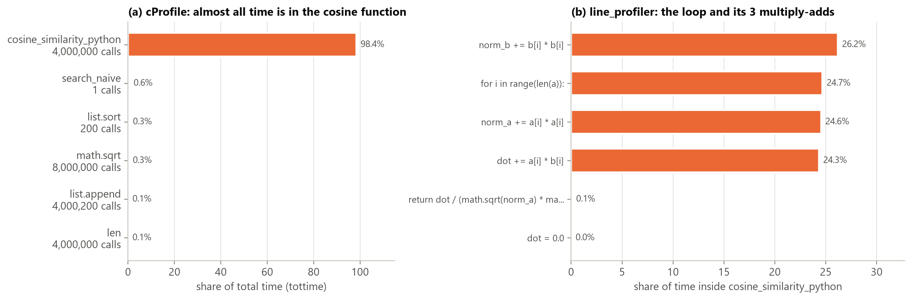

*Figure 1: The naive search spends 98.4% of its time inside `cosine_similarity_python` (4,000,000 calls, one per
query-document pair) and only 0.4% sorting. Inside the function, the loop header and the three multiply-add lines take 99.8%
of the time in near-equal shares. The cost is interpreter overhead per float operation, and two of the three multiply-adds
only recompute norms.*

* **cProfile:** `cosine_similarity_python` has 187.1 of 190.1 s own time (**98.4%**); sorting (`list.sort` + its key
  `lambda`) 0.4%, `math.sqrt` 0.3%, `list.append` 0.1%. The profiler overhead is only 1.23x (190.1 vs 154.4 s), because every
  profiled call does 768 loop iterations of real work.
* **line_profiler:** the loop header and the three multiply-add lines take 24.3–26.2% each, **99.8%** together. In
  `search_naive` the line that calls the cosine function takes 99.85%; `append` and `sort` below 0.1% each.

### 2.4 Top-3 bottlenecks

| # | Bottleneck | Evidence |
|---|---|---|
| 1 | **Interpreter overhead per float operation.** Every loop line is a bytecode step that indexes two lists, creates a new `float` object and dispatches the operation. | The four loop lines cost the same, ~12.6 ns per execution (38.6 µs / 768 iterations / 4 lines), whether or not they do useful work. The useful rate is **20 million multiply-adds/s**. One core of this CPU runs a BLAS matrix product at 312 GFLOP/s (Appendix C): 7,800x more. |
| 2 | **Redundant work.** Both norms are recomputed for every pair: the query norm 20,000 times per query, and each document norm 200 times. | Two of the four equal-cost loop lines (~50% of the time) compute norms. |
| 3 | **Data layout and full sort.** Every number is a separate 24-byte Python object behind a pointer. There is no contiguous memory and no SIMD, and the caches are used poorly. All 20,000 scores are sorted, O(N log N), although only 10 are needed. | One vector takes 24 KB as a Python list vs 3 KB as float32 (8x); the corpus takes 470 MB vs 58.6 MB. Sorting is 0.4% today, but its share grows once scoring is fast (Section 6.1). |

**Where does the time go?** To the similarity computation (98%), not to sorting (< 1%). Within the similarity computation,
it goes to *how* the numbers are processed: by the interpreter, as boxed objects scattered in memory.

### 2.5 Testing the hypotheses in pure Python

We removed each bottleneck while staying in pure Python. Every version ran the same full workload (1 warm-up + 5 runs) and
was checked against the baseline:

| Version | 200 queries x 20K docs (median) | Speed-up | Correct |
|---|---:|---:|:-:|
| Naive baseline | 154.36 s | 1.0x | ✓ |
| Fix 2: norms once (vectors normalised at indexing time) | 66.44 s | 2.3x | ✓ |
| Fix 1+3: `sum(map(mul, q, d))` + `heapq.nlargest` | 40.39 s | 3.8x | ✓ |
| NumPy, 1 thread, float64 (reference) | 65.6 ms | 2,353x | ✓ |

Normalising once shrinks the loop body from four lines to two and gives 2.3x, confirming bottleneck 2. Moving the loop into
C built-ins and selecting the top-k instead of sorting gives 3.8x – about as far as pure Python goes. NumPy on the **same
single core**, with the same algorithm, is still **616x faster** than the best pure-Python version: the remaining gap is
bottlenecks 1 and 3, the interpreter and the boxed, scattered data. Re-profiling the "norms once" version confirms it (dot
line 52.4%, loop header 47.1%, sorting 0.2%). The interpreter cannot be fixed inside Python, so Section 3 leaves it. The
baseline's top-10 lists at all four sizes (`results/1_baseline/baseline_topk.npz`) are the correctness reference for every
later version.

## 3. Matrix Operations & Dimensionality Reduction

### 3.1 Sparse vs. dense representation

**TF-IDF.** A sparse representation of the same texts: scikit-learn `TfidfVectorizer`, 10,000-term vocabulary
(`min_df=2`), L2-normalised rows, so the cosine equals the dot product. The 20,000 x 10,000 matrix has 1,832,911 non-zeros,
a **density of 0.92%** (91.6 terms per abstract, 8.0 per query).

We wrote three Numba kernels; they use `prange`, but Numba's thread count is set to **one** for a fair comparison with the
single-threaded libraries. **sparse·sparse** uses an
inverted index: X^T in CSR, i.e. for every term the list of (document, weight) pairs, built once at indexing time (7.4 ms).
It touches only the documents that share a term with the query, so it never multiplies a zero. **sparse·dense** multiplies
the CSR rows of X by the dense queries; **dense·dense** loops over the dense matrices, zeros included.

```python
@njit(parallel=True, cache=True)
def _spsp_kernel(q_indptr, q_indices, q_data, inv_indptr, inv_docs, inv_vals, n_docs):
    S = np.zeros((q_indptr.shape[0] - 1, n_docs), dtype=np.float32)
    for i in prange(q_indptr.shape[0] - 1):
        for p in range(q_indptr[i], q_indptr[i + 1]):          # each term t of query i ...
            t, w = q_indices[p], q_data[p]
            for r in range(inv_indptr[t], inv_indptr[t + 1]):  # ... and each document that contains t
                S[i, inv_docs[r]] += w * inv_vals[r]
    return S
```

**Code of all three combinations:** [`src/hpss/sparse_dense.py`](https://github.com/ahmetozanyildirim/yzm513-similarity-search/blob/master/src/hpss/sparse_dense.py) – sparse·sparse `_spsp_kernel` + `build_inverted_index` ([L46–67](https://github.com/ahmetozanyildirim/yzm513-similarity-search/blob/master/src/hpss/sparse_dense.py#L46-L67), shown above), sparse·dense `_spdn_kernel` ([L74–90](https://github.com/ahmetozanyildirim/yzm513-similarity-search/blob/master/src/hpss/sparse_dense.py#L74-L90)), dense·dense `_dndn_kernel` ([L97–112](https://github.com/ahmetozanyildirim/yzm513-similarity-search/blob/master/src/hpss/sparse_dense.py#L97-L112)); the library references `ref_*` ([L119–128](https://github.com/ahmetozanyildirim/yzm513-similarity-search/blob/master/src/hpss/sparse_dense.py#L119-L128)).

| 200 queries x 20,000 docs, 1 thread | Ours | Library | Memory of X |
|---|---:|---:|---:|
| sparse·sparse (inverted index) | **3.67 ms** | 26.4 ms (SciPy CSR @ CSR) | 14.1 MB (CSR) |
| sparse·dense | 25.6 ms | 53.5 ms (SciPy) | 14.1 MB |
| dense·dense (TF-IDF with zeros, 10,000-d) | 1,851 ms | 296 ms (BLAS) | 763 MB |
| dense embeddings (768-d) | – | 23.2 ms (BLAS) | 58.6 MB |

CSR stores only the non-zeros (value 4 B + column index 4 B, plus one row pointer per row): **54x less memory** than the
dense TF-IDF array. Our inverted index is 7x faster than SciPy's general sparse product (which must also build a sparse
result matrix), 81x faster than BLAS on the dense TF-IDF matrix, and 6x faster than scoring the 768-d embeddings. Sparsity
only pays off for very sparse data: on random matrices our kernel beats single-threaded BLAS up to 10% density (62.5 vs
72.0 ms) but loses clearly at 20% (244 vs 73 ms; Figure 2b, Appendix D). Our TF-IDF, at 0.92%, is far on the sparse side.

**Quality decides.** Speed and memory favour TF-IDF, yet the embedding finds the right abstract more often (hit@1 74% vs
68.5%; hit@10 90% for both) and matches paraphrases that share no keywords with the documents. For *"speeding up text
generation of large language models"*, TF-IDF matches the words and returns an SSD external-memory search paper first; the
embedding returns *"Mamba Drafters for Speculative Decoding"* – exactly the meaning of the query. **Decision: dense 768-d
embeddings.** Their search costs 23 ms on one thread, and the rest of this report makes it fast; a production system could
combine both (hybrid search).

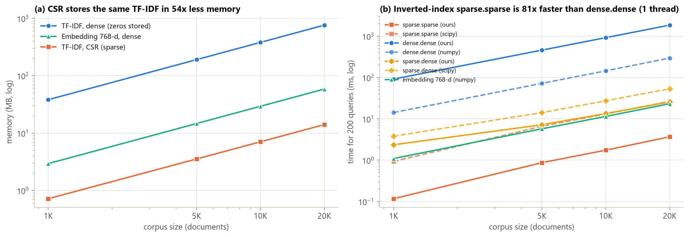

*Figure 2: For the same TF-IDF numbers, CSR storage needs 54x less memory than a dense array (14 MB vs 763 MB at 20K docs).
Our inverted-index sparse·sparse kernel is 81x faster than single-threaded BLAS dense·dense and 6x faster than scoring the
768-d embeddings. We still choose the dense embeddings (59 MB), because they rank the correct abstract first more often
(hit@1 74% vs 68.5%) and match paraphrased queries that share no keywords with the documents.*

### 3.2 Dimensionality reduction

Four methods on the normalised 20,000 x 768 corpus (`src/hpss/svd.py`): (1) **our block power iteration**, which repeats
V ← qr(X^T (X V)) until the subspace residual drops below 1e-6 (at most 100 iterations), finishes with a small k x k
SVD and never forms X^T X; (2) **NumPy full SVD** (LAPACK, ground truth); (3) **scikit-learn TruncatedSVD** (randomised); (4) **scikit-learn PCA**,
which centres the data first.

```python
V, _ = np.linalg.qr(rng.standard_normal((n, k)))   # random orthonormal start, n = 768
for it in range(max_iter):
    P = X.T @ (X @ V)                               # n x k, never forms X^T X
    resid = norm(P - V @ (V.T @ P)) / norm(P)       # how far span(V) is from an invariant subspace
    if resid < tol: break
    V, _ = np.linalg.qr(P)                          # amplify the top directions, keep them orthonormal
U0, R = np.linalg.qr(X @ V); u, S, vt = np.linalg.svd(R)   # Rayleigh-Ritz: a small k x k SVD finishes
```

**Code:** [`src/hpss/svd.py`](https://github.com/ahmetozanyildirim/yzm513-similarity-search/blob/master/src/hpss/svd.py) – `power_iteration_svd` ([L21–72](https://github.com/ahmetozanyildirim/yzm513-similarity-search/blob/master/src/hpss/svd.py#L21-L72)); all four methods behind one interface, `reduce` ([L79–105](https://github.com/ahmetozanyildirim/yzm513-similarity-search/blob/master/src/hpss/svd.py#L79-L105)).

**Verification of our implementation** (k = 50, against the full SVD; Figure 3b, Appendix D): singular values within a
median relative error of 1.1e-4 (max 6.1e-3), subspace overlap ≥ 0.993, reconstruction error only **0.00013%** above the
optimum.

| k | Method | Time | Relative Frobenius error | Peak memory |
|---:|---|---:|---:|---:|
| 50 | power iteration (ours) / full SVD / TruncatedSVD / PCA | 1.19 / 0.55 / 0.16 / 0.10 s | 0.5283 / 0.5283 / 0.5286 / 0.5271 | 24 / 379 / 134 / 23 MB |
| 100 | power iteration (ours) / full SVD / TruncatedSVD / PCA | 1.84 / 0.55 / 0.25 / 0.17 s | 0.4204 / 0.4204 / 0.4212 / 0.4198 | 47 / 379 / 150 / 23 MB |
| 200 | power iteration (ours) / full SVD / TruncatedSVD / PCA | 3.16 / 0.55 / 0.43 / 0.11 s | 0.2837 / 0.2837 / 0.2844 / 0.2834 | 94 / 379 / 181 / 36 MB |

The optimal error (Eckart–Young) is 0.5283 / 0.4204 / 0.2837. PCA comes out *below* it because it also stores the mean
vector, an extra degree of freedom.

**Why is truncated SVD faster than the full SVD?** The full SVD computes all 768 singular vectors, O(m·n²), whatever k we
need (a constant 0.55 s). The randomised solver multiplies X by a thin block of k + oversampling random columns a few times
and then takes the SVD of a small matrix: O(m·n·k). Its time therefore grows with k (0.10 s at k = 10, 1.55 s at k = 700),
and **the full SVD wins from k ≈ 300** (Figure 3a) – the practical upper limit of TruncatedSVD's advantage. Our power
iteration does the same O(m·n·k) work per iteration but, without oversampling, needs ~100 iterations: 7.5x slower than
TruncatedSVD at k = 100.

**When does PCA differ from SVD?** When the data has a non-zero mean. Our unit-length embeddings share a strong common
direction: the mean vector has norm 0.52, and the first singular vector of the uncentred matrix is 99.8% aligned with it and
carries 29% of the energy. PCA removes the mean, and with it the inner products the cosine search relies on: with the same
re-ranking it reaches recall@10 = 98.1% (92 wrong ranks), whereas TruncatedSVD and our power iteration return exactly the
baseline result.

**Which k?** The reduced space alone loses neighbours (recall@10 79.5% at k = 128, 96.6% at k = 384). We therefore fetch
100 candidates in the reduced space and re-rank them with exact 768-d cosines, which reaches 100% from k = 128 on (99.65% at
k = 96). We chose **TruncatedSVD with k = 128** (fit ~0.3 s). **An honest negative result:** at this stage the reduction did
*not* make the search faster – 22.0 ms with re-ranking vs 15.4 ms for the exact 768-d search. The product got smaller, but
the single-threaded top-k over 20,000 scores and the re-ranking remained (Section 6.1 shows why it pays off only after the
top-k is parallel). As a week-5 extra, Dask's chunked `svd_compressed` (4 chunks of 5,000 rows, k = 128) took 0.22 s vs
0.29 s for TruncatedSVD with the same error (0.3765 vs 0.3763; optimum 0.3754), and would also work out of core.

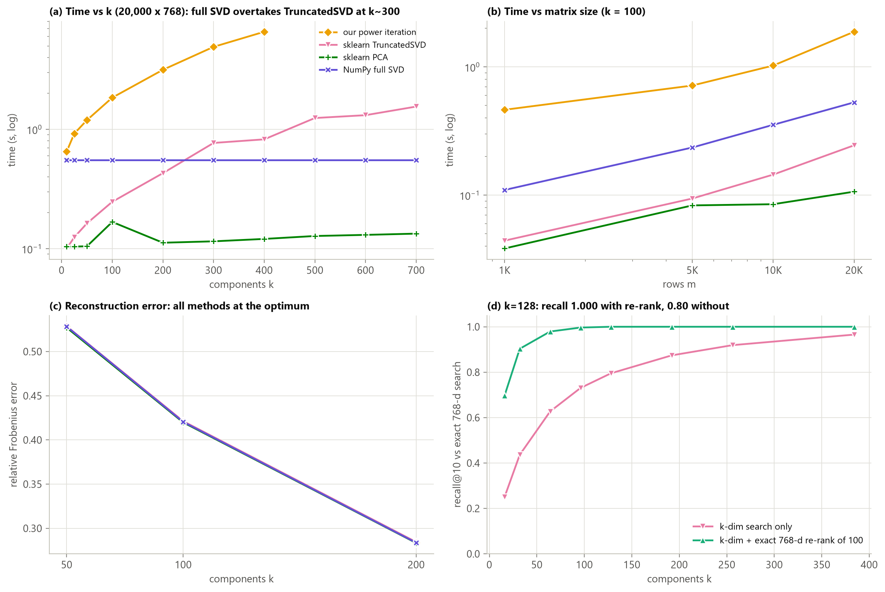

*Figure 3: Truncated (randomised) SVD reaches the optimal Eckart–Young error at k = 100 (0.421 relative) in 0.25 s, versus
0.55 s for the full SVD and 1.84 s for our power iteration; the full SVD overtakes it from k ≈ 300 on (a). At k = 128,
re-ranking 100 reduced-space candidates in full 768-d recovers 100% of the exact top-10, against 80% without re-ranking (d).
PCA is the fastest and has the lowest error, but reaches only 98.1% recall, because centring changes the cosine geometry the
search relies on.*

### 3.3 Vectorisation vs. element-wise vs. JIT

We implemented the same operation, the 200 x 20,000 cosine-similarity matrix, five ways (`src/hpss/kernels.py`). All five
use the same algorithm: norms once per row, then one dot product per pair. All ran on the full workload:

| Version | Time | vs pure Python | GFLOP/s |
|---|---:|---:|---:|
| Pure Python loops (element-wise) | 65.88 s | 1x | 0.09 |
| NumPy: two normalisations + one BLAS matrix product | 26.0 ms | 2,530x | 236 |
| Numba `@njit` (the Python loops, compiled) | 1.44 s | 46x | 4.3 |
| Numba `@njit(parallel=True)`, `prange` over documents | 106 ms | 623x | 58 |
| Numba parallel + `fastmath=True` | **19.0 ms** | **3,465x** | 323 |

**Code:** [`src/hpss/kernels.py`](https://github.com/ahmetozanyildirim/yzm513-similarity-search/blob/master/src/hpss/kernels.py) – `cosine_matrix_python` ([L28–42](https://github.com/ahmetozanyildirim/yzm513-similarity-search/blob/master/src/hpss/kernels.py#L28-L42)), `cosine_matrix_numpy` ([L46–50](https://github.com/ahmetozanyildirim/yzm513-similarity-search/blob/master/src/hpss/kernels.py#L46-L50)), `cosine_matrix_numba` ([L54–77](https://github.com/ahmetozanyildirim/yzm513-similarity-search/blob/master/src/hpss/kernels.py#L54-L77)), `cosine_matrix_numba_parallel` ([L81–104](https://github.com/ahmetozanyildirim/yzm513-similarity-search/blob/master/src/hpss/kernels.py#L81-L104)), `cosine_matrix_numba_fastmath` ([L108–131](https://github.com/ahmetozanyildirim/yzm513-similarity-search/blob/master/src/hpss/kernels.py#L108-L131)). The three Numba versions are the same loops; only the decorator (`@njit`, `parallel=True` + `prange`, `fastmath=True`) changes.

**Why each step is faster.** `@njit` (46x) removes the interpreter, but the loop still does one scalar multiply-add at a
time: strict IEEE ordering makes each 768-term sum a chain of dependent additions (~4 GFLOP/s). `prange` adds 13.6x on
16 threads. `fastmath` adds another 5.6x: it lets LLVM reorder the sum and use SIMD registers with several independent
accumulators. NumPy hands the product to BLAS (cache blocking, SIMD, threads); its 26 ms is mostly the two normalised
copies it allocates on a single thread (13.4 ms for the corpus alone) – the product itself takes 4.3 ms (§6.1). **Compile
cost:** 0.46 s for the first compilation in a fresh process, 1.1 ms per call afterwards; with `cache=True` a new process
loads the compiled code from disk in 0.26 s.

**When does Numba beat NumPy, and when does it lose?** (Figure 4b/c)
* **Numba wins when it fuses work that NumPy does in several passes with temporary arrays.** One query over 20,000
  documents: NumPy 20.1 ms (almost all of it normalising the corpus into a new array on one thread), the fused parallel
  Numba kernel **0.30 ms**. For the 200-query batch, Numba fastmath is slightly ahead too (19.0 vs 26.0 ms in the table; 20.2 vs 26.5 ms in the
  separate size sweep of Figure 4b).
* **NumPy wins on small inputs and on plain dense products.** Numba's thread pool has a fixed start cost of ~0.1 ms (10
  documents: NumPy 10 µs, parallel Numba 0.11–0.15 ms), and up to 1,000 documents NumPy is faster or equal (1.17 vs
  1.97 ms). Once normalisation is moved out of the search, the search is a bare matrix product, and BLAS's cache-blocked
  product (4.3 ms) beats any loop we can write.
* **One outlier:** NumPy with all BLAS threads at 5,000 documents took 34.5 ms vs 9.4 ms with one thread; we did not find
  the cause (the single-thread curve is smooth).

**Consequence:** BLAS for the matrix product, Numba for what BLAS cannot do – top-k selection and re-ranking (Section 6).
**Memory layout** (week 2, Figure 4d in Appendix D) mattered as much as the arithmetic: a fancy-index copy is 3,012x slower
than a slice view, an `einsum` without BLAS 75x slower than `Q @ X.T`, gathering candidate rows before re-ranking 37x slower
than reading them in place, float64 2.07x slower than float32, and normalising into a new array 1.5x slower (and twice the
peak memory) than in place. Row- vs column-major access costs only 1.04x, because the 59 MB corpus fits in the 96 MB L3.

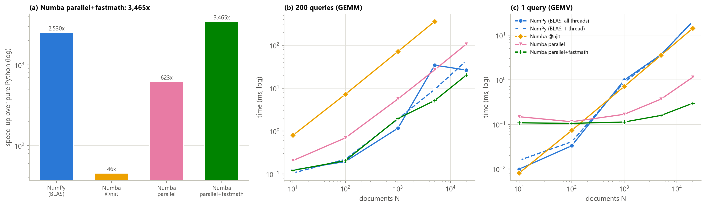

*Figure 4: Compiling the same loops with Numba gives 46x over pure Python, `prange` 623x and `prange` + `fastmath` (SIMD)
3,465x, versus 2,530x for NumPy/BLAS (a). NumPy loses whenever its single-threaded normalisation temporaries dominate: for
one query over 20,000 documents it needs 20.1 ms, versus 0.30 ms for the fused Numba kernel (c). For a 200-query batch,
Numba fastmath is slightly faster (20.2 ms vs 26.5 ms) (b).*

## 4. Parallelism & Concurrency

**Reference point:** the best single-threaded Phase-2 search including the top-k: NumPy with 1 BLAS thread, one matrix
product + `argpartition`, **33.2 ms**. We implemented **all seven strategies** of the assignment (`src/hpss/parallel.py`);
each was measured on the full 200 x 20K workload with 1–16 workers and returned the baseline top-10.

**Code of every strategy** (in [`src/hpss/parallel.py`](https://github.com/ahmetozanyildirim/yzm513-similarity-search/blob/master/src/hpss/parallel.py) unless stated otherwise):

| Strategy | Code |
|---|---|
| Pure Python: threads / processes (GIL) | `search_threadpool_python` ([L91–100](https://github.com/ahmetozanyildirim/yzm513-similarity-search/blob/master/src/hpss/parallel.py#L91-L100)), `make_python_pool` + `search_processpool_python` ([L111–132](https://github.com/ahmetozanyildirim/yzm513-similarity-search/blob/master/src/hpss/parallel.py#L111-L132)); free-threaded 3.14t: [`scripts/gil_free_threading.py`](https://github.com/ahmetozanyildirim/yzm513-similarity-search/blob/master/scripts/gil_free_threading.py) ([L22–78](https://github.com/ahmetozanyildirim/yzm513-similarity-search/blob/master/scripts/gil_free_threading.py#L22-L78)) |
| NumPy, BLAS threads | `search_blas` ([L51–53](https://github.com/ahmetozanyildirim/yzm513-similarity-search/blob/master/src/hpss/parallel.py#L51-L53)) |
| Numba `prange` | `search_numba_fused` in [`src/hpss/kernels.py`](https://github.com/ahmetozanyildirim/yzm513-similarity-search/blob/master/src/hpss/kernels.py) ([L191–222](https://github.com/ahmetozanyildirim/yzm513-similarity-search/blob/master/src/hpss/kernels.py#L191-L222)), `search_numba_threads` ([L60–68](https://github.com/ahmetozanyildirim/yzm513-similarity-search/blob/master/src/hpss/parallel.py#L60-L68)) |
| `ThreadPoolExecutor` + NumPy | `search_threadpool` ([L75–88](https://github.com/ahmetozanyildirim/yzm513-similarity-search/blob/master/src/hpss/parallel.py#L75-L88)) |
| `ProcessPoolExecutor` + shared memory / `memmap` | `SharedCorpusPool` ([L151–189](https://github.com/ahmetozanyildirim/yzm513-similarity-search/blob/master/src/hpss/parallel.py#L151-L189)), `MemmapCorpusPool` ([L196–229](https://github.com/ahmetozanyildirim/yzm513-similarity-search/blob/master/src/hpss/parallel.py#L196-L229)) |
| `asyncio` | `serve_serial`, `serve_concurrent`, `serve_batched` ([L313–340](https://github.com/ahmetozanyildirim/yzm513-similarity-search/blob/master/src/hpss/parallel.py#L313-L340)) |
| Queue + micro-batching | `serve_queue` ([L233–276](https://github.com/ahmetozanyildirim/yzm513-similarity-search/blob/master/src/hpss/parallel.py#L233-L276)) |
| Dask | `search_dask` ([L361–374](https://github.com/ahmetozanyildirim/yzm513-similarity-search/blob/master/src/hpss/parallel.py#L361-L374)), `search_dask_tree` ([L385–394](https://github.com/ahmetozanyildirim/yzm513-similarity-search/blob/master/src/hpss/parallel.py#L385-L394)), `DaskDistributedSearch` ([L409–429](https://github.com/ahmetozanyildirim/yzm513-similarity-search/blob/master/src/hpss/parallel.py#L409-L429)) |
| Ray | `ray_shard_task`, `ShardActor`, `RaySearch` ([L436–512](https://github.com/ahmetozanyildirim/yzm513-similarity-search/blob/master/src/hpss/parallel.py#L436-L512)) |
| Shard merge; race demo | `merge_topk` ([L39–44](https://github.com/ahmetozanyildirim/yzm513-similarity-search/blob/master/src/hpss/parallel.py#L39-L44)); `score_histogram_racy` / `_local` in [`src/hpss/experiments/exp3_parallelism.py`](https://github.com/ahmetozanyildirim/yzm513-similarity-search/blob/master/src/hpss/experiments/exp3_parallelism.py) ([L181–202](https://github.com/ahmetozanyildirim/yzm513-similarity-search/blob/master/src/hpss/experiments/exp3_parallelism.py#L181-L202)) |

### 4.1 Pure Python: the GIL (Figure 5a)

The naive search on 48 queries x 1,000 documents takes 1.91 s sequentially.
* **`ThreadPoolExecutor`: 1.0x at every thread count** (Amdahl p = 0.00). The GIL lets only one thread execute bytecode at a
  time (switch interval 5 ms).
* **`ProcessPoolExecutor`: 7.1x on 8 processes, 8.5x on 16** (p = 0.95): each process has its own interpreter and GIL. But
  processes pay for moving data: sending the corpus with every task pickles 317 MB in total (0.73 s), once per worker via
  the pool `initializer` only 0.27 s; a cold pool (8 `spawn`ed processes importing NumPy) costs 2.04 s, 7.7x the warm run.
* **Free-threaded CPython 3.14t** (PEP 703, no GIL) scales the same thread test 1.9x / 3.8x / 6.1x / 8.3x on 2 / 4 / 8 / 16
  threads, but its single thread is 1.85x slower (3.49 vs 1.89 s), so the net gain is 4.5x. Without the GIL races become
  real: a shared counter incremented 1.6 million times loses 80% of the increments; a lock per increment is correct but
  takes 1.46 s, local sums with one locked add per thread 4 ms.

### 4.2 Vectorised search: Amdahl's law and the serial top-k (Figure 5b)

| Strategy | How the work is split | Best config | Time | vs Phase-2 best | vs naive | Amdahl p |
|---|---|---|---:|---:|---:|---:|
| NumPy, BLAS threads | inside the matrix product | 16 threads | 16.0 ms | 2.1x | 9,631x | 0.55 |
| Numba `prange` (fused similarity + top-k) | query blocks | 16 threads | 19.7 ms | 1.7x | 7,836x | 0.98 |
| `ThreadPoolExecutor` + NumPy (1 BLAS thread/worker) | query chunks | 8 workers | 10.1 ms | 3.3x | 15,304x | 0.74 |
| `ProcessPoolExecutor` + shared memory | query chunks | 12 workers | 10.7 ms | 3.1x | 14,369x | 0.74 |
| `ProcessPoolExecutor` + `np.memmap` file | query chunks | 8 workers | 9.7 ms | 3.4x | 15,866x | – |
| Dask `delayed` (threads) | 8 document shards + merge | 8 workers | **8.9 ms** | **3.7x** | 17,390x | 0.79 |
| Ray actors (stateful shards) | 8 document shards | 8 shards | 10.6 ms | 3.1x | 14,576x | – |
| Ray tasks (`ray.put` shards) | 8 document shards | 8 shards | 11.8 ms | 2.8x | 13,049x | – |

**BLAS threads stop at 2.1x, and the reason is Amdahl's law.** We timed the two steps separately:

| BLAS threads | Matrix product | Top-k (`argpartition`) | Serial share |
|---|---:|---:|---:|
| 1 | 22.8 ms | 10.1 ms | 31% |
| 16 | 4.3 ms | 10.2 ms | **70%** |

The product gets 5.3x faster with more threads, but the single-threaded top-k does not change: once the product is
parallel, the top-k is 70% of the time. Amdahl's law caps the speed-up at 1/(1 − p): with the 31% serial share measured on
one thread (p = 0.69) the ceiling is 3.2x, and the fitted p = 0.55 is lower still because the product itself scales only
5.3x on 16 threads (shared memory bandwidth, SMT).
**Splitting by queries or shards parallelises the top-k as well** (p = 0.74–0.79). They still stay far from linear because
every worker streams the whole 58.6 MB corpus through the same L3 and memory bus (bandwidth), a search call for 25 queries
costs 0.28 ms per query against 0.17 ms for all 200 (one BLAS thread), and above 8 workers two SMT threads share one core's floating-point
units. **The fused Numba kernel scales almost perfectly** (8.0x on 8 cores, 11.6x on 16, p = 0.98: no serial part, only
read-only sharing), but from a slow single thread (228 ms), because it streams the corpus once per query without cache
blocking. **Good scaling is not the same as fast.**

**Three pitfalls we measured.** *Oversubscription:* a thread pool whose workers each use 16 BLAS threads (256 threads on 16
hardware threads) takes 84.9 ms instead of 12.4 ms. *Granularity* (Figure 5c, Appendix D): the best task is 25 queries
(8 tasks for 8 workers, 10.0 ms); 2-query tasks (46.6 ms) are even slower than 1-query tasks (17.6 ms), because with two
queries BLAS switches from matrix-vector to matrix-matrix, which first packs the whole corpus (~3.2 ms per call). *A race in
`prange`:* 16 threads adding into one shared histogram lose up to 2.6 million of 4 million updates, and are 50x slower than
private rows combined once (17.0 vs 0.34 ms), because the cores fight over the same cache lines.

### 4.3 What each tool is for

| Tool | What we measured | The right tool when … |
|---|---|---|
| Process pool + shared memory / `memmap` | Corpus placed once; a task sends 75 KB of queries, gets 2.9 KB back: 10.7 / 9.7 ms. A cold pool costs 2 s. | CPU-bound Python; read-only data shared by many processes |
| `asyncio` | 100 queries waiting for a simulated 20 ms API: serial 2.85 s, `gather` 41.9 ms (68x), `gather` + one batched product 40.6 ms. No gain for CPU work (18.7 vs 19.8 ms). | Many concurrent I/O waits (embedding API calls) |
| Queue + micro-batching | 200 queries at once: batches of 200 give 12,453 q/s (p95 16 ms), batches of 1 give 5,417 q/s (p95 35 ms). One query every 0.5 ms: ~986 q/s for every batch size. | Online serving, when a queue forms |
| Dask | Threads 8.9 ms (merge = 4% of the time, Fig. 5d); processes 1.04 s per call (ships the shards); `LocalCluster` 38 ms + 1.6 s start-up; `dask.array` 48–58 ms; 64-shard flat merge 20.0 ms vs tree 22.7 ms. | Data larger than RAM; many machines |
| Ray | `ray.init` 12.1 s; actors 10.6 ms, tasks 11.8 ms, `ray.wait` 11.6 ms; with 30% of attempts failing still exact (2.0 s, retries). | Many independent tasks, stateful workers, fault tolerance |

A pure-Python pipeline (week 5: document frequencies over 3.56 M words) shows the same pattern: serial `Counter` 0.41 s,
Dask Bag with threads 0.64 s (GIL), Dask Bag with processes 0.68–2.17 s, Ray with a tree merge 0.26 s after 5.6 s of
start-up. On Windows, `asyncio.sleep(0.02)` actually sleeps 29.5 ms (timer resolution).

**Best speed-up per unit of code complexity?** BLAS threads cost zero lines but are capped at 2.1x by the serial top-k.
Among the Phase-3 strategies, `ThreadPoolExecutor` + NumPy gives 3.3x for ~15 lines and Dask `delayed` (threads) the best
3.7x for similar code; process pools need ~60 lines and a start-up for no more, Ray a 12 s initialisation. **The best ratio
overall is a ~20-line Numba top-k that removes the serial part** (§6.1): exact search 15.5 → 5.4 ms, faster than any
framework. **For a 10x larger corpus** the strategy stays the same – 200K documents (586 MB) still fit in RAM, so threads in
one process remain right – but the bottleneck becomes memory bandwidth (the corpus leaves L3), so batching and a smaller
128-d index matter more (§6.3). Dask and Ray become the right choice only when the data no longer fits one machine (§6.5).

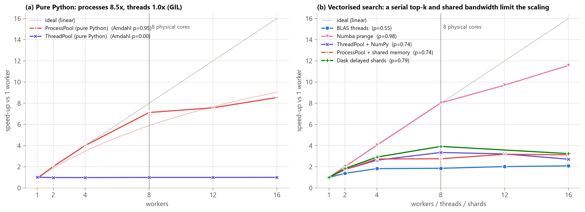

*Figure 5: With pure Python, processes reach 8.5x (Amdahl p = 0.95) while threads stay at 1.0x because of the GIL (a). For
the vectorised search, BLAS threads stop at 2.1x (p = 0.55), because the top-k selection after the matrix product is
single-threaded. Strategies that split the work into query chunks or shards also parallelise the selection (p = 0.74–0.79),
and the fused Numba kernel has no serial part at all (p = 0.98) (b).*

## 5. Design Decisions

| Decision | Choice | Alternatives considered | Evidence |
|---|---|---|---|
| Representation | Dense 768-d embeddings | TF-IDF in CSR (54x less memory, 6x faster) | Embeddings find the right abstract more often (hit@1 74% vs 68.5%) and handle paraphrases (§3.1). |
| Precision | float32 | float64 | Matrix product 2.07x faster. Largest score error 4.9e-7, well within the 1e-5 tolerance (the expected error is about √768 · 1.2e-7 ≈ 3.3e-6) (§3.3, §6.2). |
| Normalisation | Once, at indexing time, in place | Inside every search; new arrays | Python: 2.3x (§2.5). NumPy: normalising the corpus in every call costs 13.4 ms, more than the 4.3 ms product (§3.3). |
| Dimensionality reduction | TruncatedSVD, k = 128 | Full SVD; our power iteration; PCA | Fit in ~0.3 s with optimal error. The full SVD is slower below k ≈ 300; the power iteration is 7.5x slower; PCA breaks the cosine geometry (98.1% recall) (§3.2). |
| Candidates for re-ranking | c = 100 | 10, 20, 50, 200 | The smallest c with 0 rank violations on all 200 queries at all sizes (§6.2). |
| Similarity kernel | One batched BLAS matrix product (GEMM) | Numba fused kernel; one matrix-vector product per query | The batched GEMM is compute-bound (1.1–1.4 TFLOP/s, Appendix C). The fused kernel slows down 36x for 10x data once the corpus leaves L3 (§6.3). |
| Top-k selection | Parallel Numba top-k | `np.argpartition` (1 thread); full sort | 0.24 ms vs 10.2 ms (43x). This was the serial fraction that capped every parallel strategy (§4.2, §6.1). |
| Parallelism | Threads inside one process (BLAS + Numba) | Process pools, Dask processes / distributed, Ray | The data fits in RAM and L3; process pools add 1–2 s of start-up, Ray 12 s. At this size, removing the serial part (5.4 ms) beats every framework (8.9–11.8 ms) (§4). |
| Two thread pools | `OMP_WAIT_POLICY=PASSIVE` (set by `import hpss`) | Default spinning OpenMP threads | Spinning Numba threads slow the next BLAS product from 4.4 to 34.1 ms (§6.1). |
| Batching | 200 queries per call (GEMM) | One query per call (GEMV) | 0.17 ms vs 0.53 ms per query (search call, 1 BLAS thread); a single query of the final engine takes only 0.21 ms (§4.2, §6.3). |

## 6. Final System & Scaling

### 6.1 Profiling our own engine: the serial part moved

After Phase 3, we profiled our own search the same way we profiled the baseline, stage by stage (200 x 20K, in ms):

| Engine variant | Normalise / project | Matrix product | Top-k | Re-rank | **Total** |
|---|---:|---:|---:|---:|---:|
| Exact 768-d + `argpartition` | 0.09 | 4.28 | **10.23** | – | 15.55 |
| Exact 768-d + parallel top-k | 0.09 | 4.32 | 0.24 | – | 5.36 |
| SVD-128 + re-rank(100) + `argpartition` + gather/einsum | 0.36 | 1.86 | **10.12** | **8.84** | 21.93 |
| SVD-128 + re-rank(100) + parallel top-k + in-place re-rank | 0.20 | 1.82 | 0.58 | 0.45 | **3.67** |

Separate experiments give the final engine 3.64–3.89 ms; the headline numbers use the scaling run (3.89 ms, §6.3).

* **The new bottleneck is the top-k:** the single-threaded `argpartition` is 66% of the exact search. A parallel Numba top-k
  (each thread keeps a 10-element sorted buffer for its block of queries) makes that step 43x faster.
* **This explains the negative result of §3.2.** The 128-d product is 2.3x cheaper than the 768-d one, but the saving shows
  only after the top-k (10.1 → 0.58 ms) and the re-rank (8.8 → 0.45 ms: reading candidate rows in place instead of
  gathering them into a copy) are fixed.
* **Two thread pools must not compete.** By default Numba's OpenMP threads keep spinning after a parallel region, and the
  next BLAS product fights them for the cores: **34.1 ms instead of 4.4 ms**. With `OMP_WAIT_POLICY=PASSIVE` idle threads
  sleep, and the final engine needs 3.64 instead of 7.01 ms (Figure 6a, Appendix D).

### 6.2 The final pipeline and its correctness

```python
class SearchEngine:                       # src/hpss/search.py (abridged)
    def fit(self, X):                     # once, at indexing time
        self.X  = normalize_rows(X).astype(np.float32)                   # 20,000 x 768, unit rows, C order
        fit     = reduce(self.X, 128, method="truncated_svd")            # ~0.3 s
        self.P  = fit["components"].astype(np.float32)                   # 128 x 768
        self.Xr = normalize_rows(self.X @ self.P.T)                      # 20,000 x 128 index (9.8 MB)

    def search(self, Q, k=10):
        Qn   = normalize_rows(Q)                                         # 200 x 768
        S    = normalize_rows(Qn @ self.P.T) @ self.Xr.T                 # BLAS GEMM in 128-d: 1.8 ms
        cand, _ = topk_rows(S, 100)                                      # parallel Numba top-100: 0.6 ms
        exact   = candidate_scores(Qn, self.X, cand)                     # exact 768-d cosines, in place: 0.5 ms
        order, scores = topk_from_scores(exact, k)                       # top-10 of 100
        return np.take_along_axis(cand, order, axis=1), scores
```

**Code:** `SearchEngine` in [`src/hpss/search.py`](https://github.com/ahmetozanyildirim/yzm513-similarity-search/blob/master/src/hpss/search.py) ([L59–143](https://github.com/ahmetozanyildirim/yzm513-similarity-search/blob/master/src/hpss/search.py#L59-L143)); the parallel top-k `topk_rows` and the in-place re-rank `candidate_scores` in [`src/hpss/kernels.py`](https://github.com/ahmetozanyildirim/yzm513-similarity-search/blob/master/src/hpss/kernels.py) ([L138–184](https://github.com/ahmetozanyildirim/yzm513-similarity-search/blob/master/src/hpss/kernels.py#L138-L184)).

**Pipeline:** data → embedding (offline) → normalise → TruncatedSVD to 128-d → batched BLAS search → parallel top-100 →
exact 768-d re-rank → top-10. Re-ranking computes exact 768-d scores for the selected candidates; it cannot recover
true neighbours excluded from the candidate pool. The pipeline is therefore approximate. The 100% recall below is an
observation on these 200 queries, not an exactness guarantee for unseen queries.

How many candidates are needed (200 x 20K)?

| Candidates c | Time | recall@10 | Rank violations | Largest score difference |
|---:|---:|---:|---:|---:|
| 10 | 2.92 ms | 0.795 | 749 | 0.075 |
| 50 | 3.20 ms | 0.994 | 33 | 0.011 |
| **100** | **3.70 ms** | **1.000** | **0** | **7.7e-8** |
| 200 | 4.93 ms | 1.000 | 0 | 7.7e-8 |

**Correctness:** four versions (exact BLAS, exact + parallel top-k, Numba fused, final) at 1K, 5K, 10K and 20K documents
all return the baseline's top-10 for every query (index match 100%, no tie swaps). The largest score difference is 4.9e-7
for exact float32 BLAS and 7.7e-8 for the final engine, far below the 1e-5 tolerance.

### 6.3 Scaling (Figure 6)

Search time at 1K, 2K, 5K, 10K and 20K real documents, and – to see beyond the dataset – at 50K, 100K and 200K synthetic
documents (copies of the real embeddings plus small noise; measured, not extrapolated). The table shows a subset; all sizes
are in Figure 6 and `results/4_final_system/scaling.csv`.

| 200 queries | 1K | 5K | 10K | 20K | 200K (synthetic) | Slope 5K–20K | Slope 20K–200K |
|---|---:|---:|---:|---:|---:|---:|---:|
| Naive Python | 7.73 s | 38.6 s | 77.6 s | 154.4 s | – | 1.00 | – |
| Exact BLAS + `argpartition` | 0.89 ms | 4.27 ms | 7.70 ms | 15.7 ms | 149 ms | 0.94 | 0.98 |
| Numba fused | 0.91 ms | 4.46 ms | 9.11 ms | 18.3 ms | 655 ms | 1.02 | **1.56** |
| **Final engine** | 0.88 ms | 1.84 ms | 2.55 ms | **3.89 ms** | 27.5 ms | **0.54** | 0.85 |

**Does the system scale linearly?** At most linearly: the final engine grows with a log-log slope of 0.54 between 5K and
20K documents (0.19 ms per 1,000 documents at 20K). It is sub-linear because several costs do not depend on N – projecting
the queries, starting the threads, selecting and re-ranking 100 candidates per query. **Where does it break down? When the
corpus leaves the 96 MB L3 cache.** The exact single-query latency is 0.19 ms at 20K (59 MB) but 1.58 ms at 50K (147 MB) –
8.4x the time for 2.5x the data – and 11.1 ms at 200K. The fused Numba kernel, which reads the corpus once per query,
suffers most (36x slower for 10x the data). The final engine scans the 128-d index (98 MB at 200K) and touches only 100 rows
of the 768-d matrix per query: **0.53 ms** per single query at 200K. **With 10x more data** we would keep exactly this
engine – it still fits in RAM, and the reduced index keeps the scan close to the cache (200 queries in 27.5 ms at 200K).

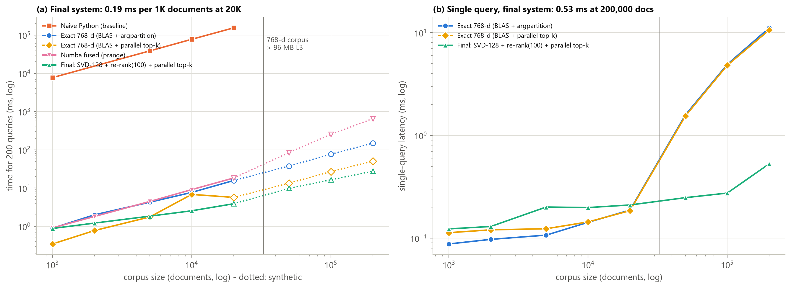

*Figure 6: Search time grows at most linearly with corpus size. The log-log slope of the final engine is 0.54 between 5K and
20K documents and 0.85 up to 200K synthetic documents; it is below 1 because fixed per-call costs still matter (a). The fused
Numba kernel, which re-reads the corpus for every query, slows down 36x for 10x the data once the corpus leaves the 96 MB L3
cache; so does the exact single-query latency (b). The final engine answers 200 queries over 20K documents in 3.89 ms and a
single query in 0.21 ms.*

### 6.4 All versions

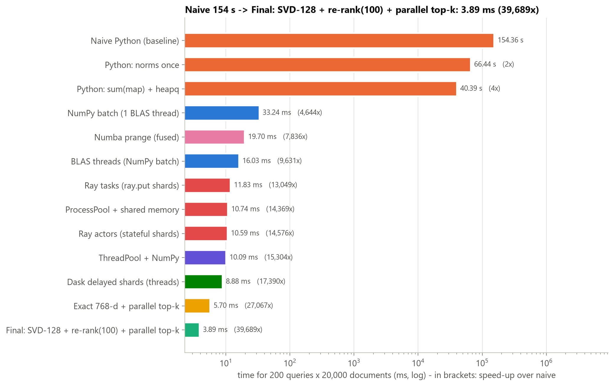

*Figure 7: From 154 s (naive Python) to 3.89 ms (final engine: SVD-128 + re-rank(100) + parallel top-k) on the same
200 x 20K workload, a 39,689x speed-up with identical results. Python-level fixes alone reach at most 3.8x; the big jump
comes from leaving the interpreter (BLAS / Numba, 4,644x), and the last 8.5x comes from profiling our own engine and
removing its serial part.*

**Live demo:** `python scripts/demo.py --compare-naive "speculative decoding for LLM inference"` loads the index and answers
typed queries in real time, optionally next to the naive search.

### 6.5 What would change at 100 million documents (week 5)

At 100M documents the corpus no longer fits one machine (307 GB at 768-d, 51 GB at 128-d vs 33.5 GB = 31.2 GiB of RAM),
and one full scan at the 58.9 GB/s we measured for a 614 MB matrix-vector scan takes 5.2 s. The engine would be **sharded by document** (one shard per machine, the query
moves – 3.1 KB out, 120 B back per shard – not the data), use an approximate index (HNSW/IVF, Appendix C) instead of a full
scan, and retry failed shard tasks (with 1,000 machines x 24 h, a failure somewhere is 63% likely). Encoding, not search,
becomes the expensive step: 127 days for 100M abstracts at our measured 9.1 abstracts/s. The numbers behind these walls
are in Appendix E.

## 7. Discussion & Lessons

**What surprised us:**
1. **The profiler was wrong before the code was.** On Python 3.12, cProfile inside Jupyter attributed time to the kernel's
   I/O threads (a `_select` row appeared, and `list.sort` was shown as called by it): 3.12's `sys.monitoring` sees all
   threads but keeps one call stack. Profiling in a separate process fixed it. Lesson: check that a profile is plausible.
2. **Dimensionality reduction alone made the search slower** (22.0 vs 15.4 ms): the cost was not in the product the
   reduction shrinks but in the top-k and the re-ranking, which only profiling our own engine (§6.1) showed. The
   optimisation that mattered most was the least glamorous one: a 20-line parallel top-k.
3. **Two correct, fast thread pools can make each other 8x slower.** Spinning OpenMP threads competed with BLAS threads for
   the same cores (34.1 vs 4.4 ms).
4. **The big frameworks lost at this scale.** Ray needs 12 s just to start, and Dask's process scheduler 1 s per call. The
   58.6 MB corpus fits in the L3 cache, so plain threads win.
5. **Free-threaded Python really scales pure-Python threads** (8.3x on 16), but a single thread is 1.85x slower, and races
   that the GIL used to hide appear immediately.

**What we would do differently or with more time.** Profile the whole engine stage by stage right after Phase 2C instead of
after Phase 3 – we would have found the serial top-k a phase earlier. Store the corpus as int8 or with product quantisation
(4–32x less memory traffic), use an IVF or HNSW index beyond ~1M documents, run the GPU version (week 6, out of scope here),
and repeat the scaling test on a second machine (e.g. Colab) to separate machine-specific effects, such as the 96 MB L3, from
general ones.

**Connection to real AI systems.** Vector databases (FAISS, Milvus, pgvector) and the retrieval step of RAG systems are built
from the pieces we measured: normalised float32 vectors and batched matrix products (BLAS on CPU, cuBLAS on GPU), heap- or
partition-based top-k, two-stage retrieval (cheap candidate generation, then exact or cross-encoder re-ranking), and sharding
by document with a merge of per-shard top-k lists. Our numbers show why these designs exist: the arithmetic is cheap; memory
traffic, serial steps and moving data cost the time.

**Limitations.**
* **One machine**, a Windows desktop with an unusually large L3 cache. With 16–32 MB of L3 (a typical laptop) the cache
  cliff would be expected at ~5–10K documents instead of between 20K and 50K.
* **Synthetic data beyond 20K:** noisy copies of real embeddings – valid for timing, not for quality.
* **c = 100 candidates** was verified on these 200 queries at four corpus sizes; it is not a guarantee for unseen queries
  (a query whose true neighbours are poorly represented in 128-d could miss one).
* **Millisecond timings are sensitive to OS scheduling.** We report medians of ≥ 5 runs (std in `results/`); a few points
  are noisy (exact search at 10K: std 8–14 ms), and one outlier is unexplained (NumPy at 5K, §3.3).
* **Queries are paper titles**, one specific kind of query; embedding time (2,199 s for the corpus) is outside every
  benchmark, as the assignment specifies.

<div class="pagebreak"></div>

## Appendix

### A. Dataset details

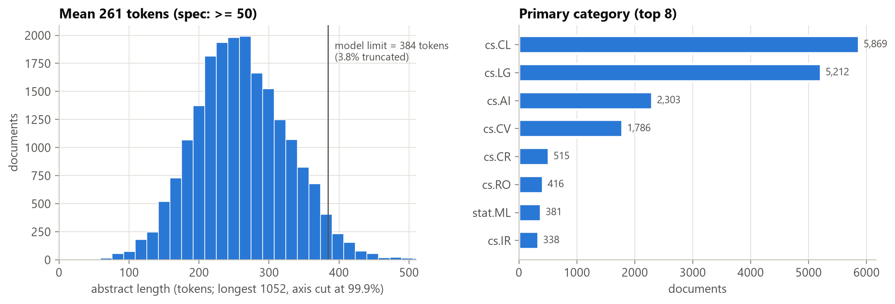

*Figure 0: The corpus consists of 20,000 arXiv abstracts (2025–26), 261 tokens long on average, well above the 50-token
minimum. Only 3.8% exceed the embedding model's 384-token window.*

The raw records come from 63 (month, category) cells of 500 papers each. Preprocessing is in `src/hpss/data.py`; the processed
corpus and queries are in `data/processed/` (`corpus.jsonl`, `queries.jsonl`).

### B. Code, requirements and reproduction

* **Repository:** <https://github.com/ahmetozanyildirim/yzm513-similarity-search>. The full code is in `src/hpss/`, one experiment module per phase in
  `src/hpss/experiments/`.
* **Requirements:** `requirements.txt`. Tested with Python 3.12.10 on Windows 11. The main packages are numpy, scipy,
  scikit-learn, pandas, matplotlib, threadpoolctl, psutil, sentence-transformers, line_profiler, py-spy, numba,
  dask[array,distributed], ray and faiss-cpu.
* **Reproduce:**

```bash
python -m venv .venv && .venv\Scripts\activate      # Linux/macOS: source .venv/bin/activate
pip install -r requirements.txt && pip install -e .
python scripts/prepare_data.py      # download + preprocess + embed (cached)
python scripts/run_all.py           # all phases, ~70 min on this machine (full workloads, no extrapolation)
python scripts/build_report.py      # this PDF (Markdown -> HTML -> PDF with Edge/Chrome)
python scripts/demo.py --compare-naive "speculative decoding for LLM inference"
```

* **Raw benchmark data:** every phase writes `results/<phase>/results.json` (key numbers and figure captions), CSV files with
  every measurement (median, std, raw runs where relevant), and each figure as PNG and PDF.
  * **Phase 1:** `naive_scaling.csv`, `python_fixes.csv`, `cprofile.txt`, `line_profiler.txt`, `flamegraph.svg`,
    `baseline_topk.npz`.
  * **Phase 2A:** `times.csv`, `memory.csv`, `density_sweep.csv`.
  * **Phase 2B:** `time_vs_k.csv`, `time_vs_m.csv`, `errors_memory.csv`, `search_quality.csv`.
  * **Phase 2C:** `main_comparison.csv`, `size_sweep.csv`, `memory_layout.csv`.
  * **Phase 3:** `scaling_all.csv`, `summary.csv` and one CSV per experiment (A–I).
  * **Phase 4:** `scaling.csv`, `correctness.csv`, `candidates.csv`, `stage_profile.csv`, `thread_contention.csv`, `scale_*.csv`.
  * **Phase 5:** `roofline_points.csv`, `ann.csv`.

### C. Bonus: roofline model and approximate nearest neighbours

Bonus items covered in this report:
* **More than 3 parallelism strategies:** all 7 (§4).
* **Both Dask and Ray** (§4.3).
* **A roofline model** and **approximate nearest neighbours**, below.

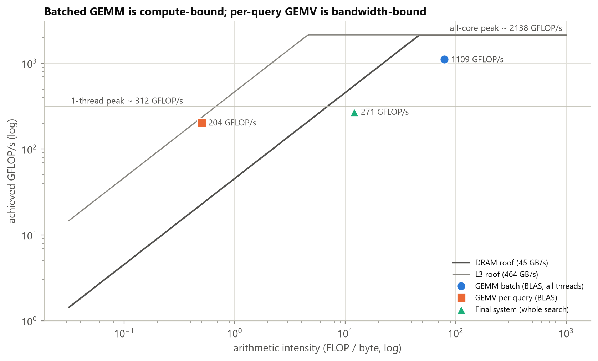

*Figure 8 (bonus): The batched matrix product runs at 1,109 GFLOP/s (arithmetic intensity ≈ 79 FLOP/B, 52% of the measured
2,138 GFLOP/s compute roof). The per-query matrix-vector product reaches only 204 GFLOP/s at AI = 0.5: 88% of the 232 GFLOP/s
that the L3 bandwidth (464 GB/s) allows at that intensity. Batching queries is what moves the search from memory-bound to
compute-bound.*

**Roofline inputs:** the measured compute roof is 2,138 GFLOP/s on all cores and 312 GFLOP/s on one thread. The measured
bandwidth is 464 GB/s from L3 and 45 GB/s from DRAM. The whole final engine runs at 271 GFLOP/s (AI ≈ 12): its cheap 128-d
product is no longer the dominant cost. The roofline's GEMM point was timed on its own (5.5 ms for 200 x 20K); inside the
engine profile the same product took 4.3 ms (≈ 1,430 GFLOP/s). The DRAM roof comes from a 3 GB STREAM triad (two reads and one
write per element), whereas the 58.9 GB/s of Appendix E is a read-only matrix-vector scan over 614 MB on all threads.

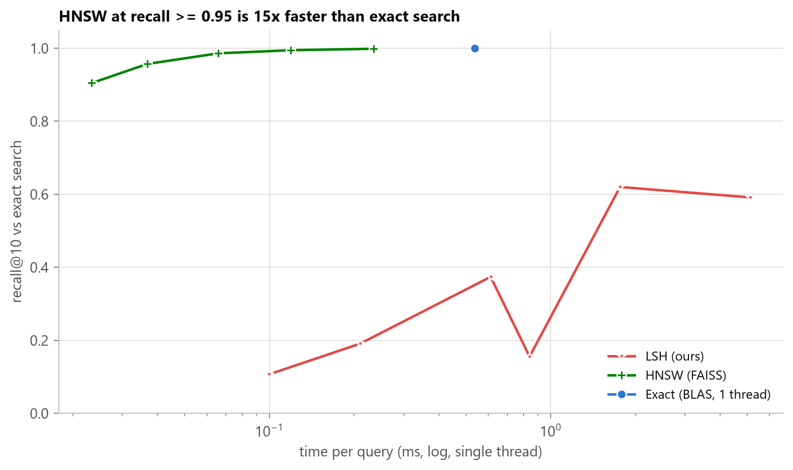

*Figure 9 (bonus): HNSW (FAISS) reaches recall@10 = 0.998 at 0.235 ms per query, versus 0.537 ms for exact single-threaded
search. Our SimHash LSH needs to scan a large fraction of the corpus for high recall in 768 dimensions. At 20K documents,
exact search is already sub-millisecond, so ANN only pays off at much larger N.*

**HNSW:** the index builds in 1.67 s. Recall goes from 0.904 (efSearch = 16, 0.023 ms per query) to 0.9985
(efSearch = 256, 0.235 ms).

**Our random-hyperplane LSH:**
* With 8-bit codes in 16 tables, it scans 17.6% of the corpus and reaches recall 0.62.
* With 16-bit codes, most buckets are nearly empty. The query then falls back to a full scan, which is why that setting is
  the slowest (5.1 ms per query) despite its tiny average candidate count.

### D. Additional figures

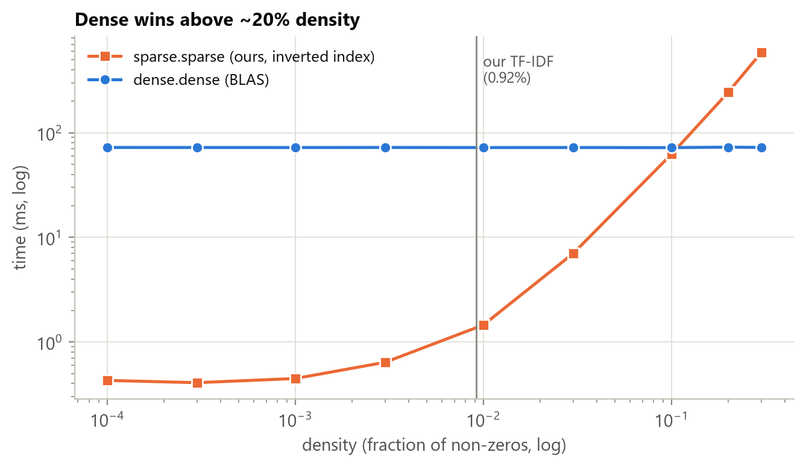

*Figure 2b: Sparse storage only pays off for very sparse data. With single-threaded kernels, BLAS dense·dense overtakes our
sparse kernel between 10% and 20% density, while our TF-IDF matrix is 0.92% dense.*

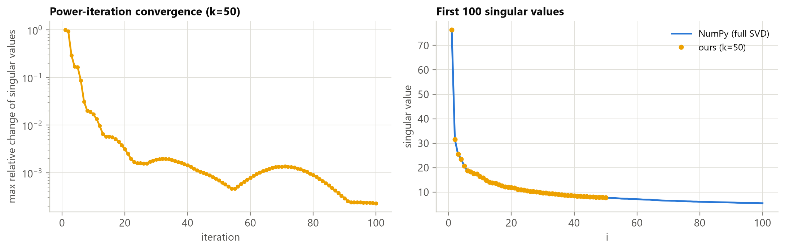

*Figure 3b: Our block power iteration converges to the true singular values (median relative error 1.1e-4) and subspace
(overlap ≥ 0.993). Its reconstruction error is within 0.00013% of the Eckart–Young optimum.*

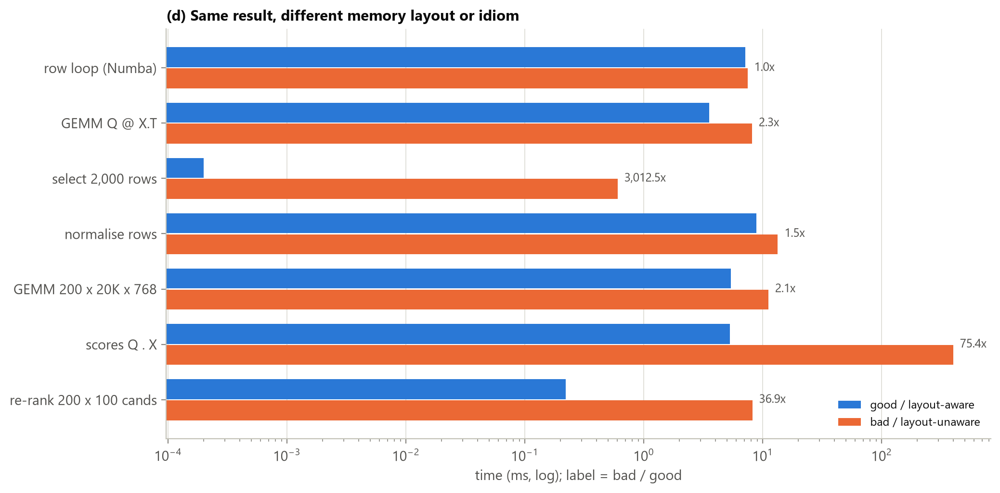

*Figure 4d: How the data is laid out and touched matters as much as the arithmetic: a fancy-index copy is 3,012x
slower than a slice view, an `einsum` that bypasses BLAS 75x slower than `Q @ X.T`, gathering candidate rows before
re-ranking 37x slower than reading them in place, and float64 2.1x slower than float32. Row-major vs column-major access
costs only 1.04x here, because the 59 MB corpus fits in the 96 MB L3 cache.*

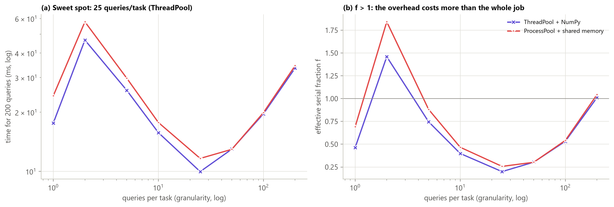

*Figure 5c: Granularity is the master dial. With 8 workers, the 200 queries run fastest as tasks of 25 queries (10.0 ms,
effective serial fraction f = 0.20). One task with all the queries leaves the other workers idle (33.5 ms). Tiny tasks drown
in overhead: 2-query tasks (46.6 ms) are even slower than 1-query tasks (17.6 ms), because BLAS switches from a matrix-vector
to a matrix-matrix product that first packs the whole corpus.*

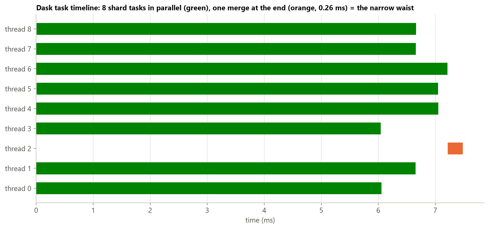

*Figure 5d: Dask's task stream for one sharded search. The 8 shard tasks run side by side on 8 threads (6.7 ms each). The
single merge, the graph's narrow waist, takes 0.26 ms: only 4% of the 7.5 ms wall time, so a flat merge is enough at this
scale.*

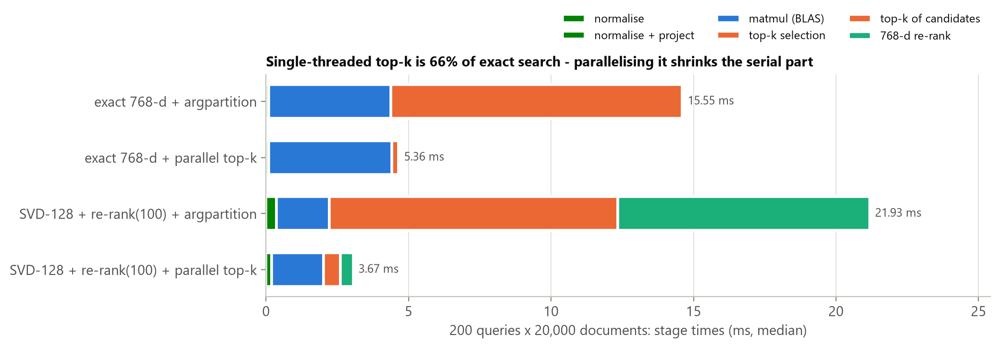

*Figure 6a: Profiling our own engine shows that the single-threaded `argpartition` takes 66% of the exact batched search
(10.23 of 15.55 ms): the serial fraction of Amdahl's law. A parallel Numba top-k cuts the search to 5.36 ms, and the final
SVD-128 + re-rank(100) + parallel top-k engine needs 3.67 ms.*

### E. Scale walls at 100 million documents and the five questions of week 5

| Wall | At 100M documents | Consequence |
|---|---|---|
| Memory | 768-d float32: 307 GB (9.2x this machine's 33.5 GB of RAM); 128-d: 51 GB (1.5x) | Shard by document across machines. |
| Scan time | One pass at 58.9 GB/s (measured: matrix-vector scan over 614 MB, all threads): 5.2 s (768-d), 0.87 s (128-d) | Approximate search (HNSW/IVF, Appendix C) instead of a full scan. |
| Data moved | 32 shards of 9.6 GB scan in 163 ms each; a query sends 3.1 KB to each shard and gets 120 B back | Move the query, not the data. |
| Encoding | At the measured 9.1 abstracts/s on this CPU: 127 days on one machine. With 2% serial work, 128 machines give only 36x: 3.5 days | Encoding, not search, is the expensive offline step (a GPU or an API). |
| Failures | With 1,000 days between failures per machine: 4.2% for 128 machines x 8 h, 63% for 1,000 machines x 24 h | Retries are mandatory; shard tasks are pure, so retrying them is safe. |

| Question | Our engine (20K documents) | The same search at 100M documents |
|---|---|---|
| Split | The matrix product: BLAS blocks. Top-k and re-rank: the 200 query rows over the Numba threads. The corpus stays whole (59 MB, fits L3). | By document: 32–128 shards of the corpus, one per machine. |
| Assign | Static: BLAS and OpenMP give every thread an equal block (every query costs the same). | One task per shard (Dask / Ray scheduler); stateful actors keep their shard loaded. |
| Move | Nothing: shared memory; the corpus is read in place (no pickling). | 3.1 KB of query out, 120 B of (id, score) back per shard. |
| Wait | One barrier at the end of `prange`; the batch of 200 queries takes 3.89 ms. | The slowest shard, then a merge of shards x k results (a tree merge when the fan-in is large). |
| Fail | A crash restarts the query (milliseconds, nothing to save). | Retry the shard task. It is read-only and pure, so running it twice is safe (measured: 30% failed attempts, still exact). |

<div class="pagebreak"></div>

### F. Joint validation and new measurements on a second machine

We ran an additional comparison on the same 20,000 abstracts under Linux ARM64. This run uses TF-IDF with 4,096
features, TruncatedSVD to 128 dimensions, and float64. We use the first 50 stored titles as queries and fit the
transformers on abstracts only. This representation differs from the main experiment's 768-d MPNet embeddings.
Speedups therefore compare identical vectors on this machine only; the Windows timings are not a hardware baseline.

**Environment and method.** Linux aarch64, 4 cores, 23.4 GiB RAM, Python 3.14.4, NumPy 2.5.4, Numba 0.68.0 and OpenBLAS.
We measure eight implementations at 1K, 5K, 10K and 20K documents: 32 configurations. Each has 3 warmup calls followed
by 5 timed iterations, or 160 timed measurements in total. Preparation and SVD fitting are excluded from search time.
The thread pool is created before timing; Python list conversion is also excluded. The Numba matrix implementations
recompute norms inside the search; BLAS and the fused kernels use prepared unit vectors. This compares complete
implemented search paths, not the compiler in isolation.

| 50 queries × 20,000 documents × 128 dimensions | Median search (ms) | Speedup over same-machine baseline |
|---|---:|---:|
| Pure Python | 20,071.953 | 1.00× |
| NumPy BLAS, 1 thread | 27.430 | 731.76× |
| NumPy BLAS, 4 threads | 15.343 | 1,308.21× |
| Numba serial cosine matrix + selection | 100.737 | 199.25× |
| Numba parallel cosine matrix + selection | 46.196 | 434.50× |
| Fused Numba, 1 thread | 35.772 | 561.11× |
| Fused Numba, 4 threads | 18.057 | 1,111.60× |
| ThreadPool, 4 workers; 1 BLAS thread per worker | 9.856 | 2,036.55× |

All 32 comparisons match the baseline's top-10 document IDs exactly. The largest absolute score difference is below
1.56e-15, versus a tolerance of 1e-5. ThreadPool wins at 20K in this run; the Windows/MPNet ranking does not necessarily
transfer to another machine and representation.

The five raw timings, mean, standard deviation, data/code SHA-256 fingerprints and package versions are in
`results/validation_arm64/tfidf_svd_50q/summary.json`; see `timings.csv` for tables and `scaling.png` for all sizes.
Reproduce with:

```bash
OMP_NUM_THREADS=4 OPENBLAS_NUM_THREADS=4 NUMBA_NUM_THREADS=4 \
python scripts/validate_independent.py --output results/validation_arm64/new_run
```

**Correctness fixes.** Regression tests cover wrong document IDs accepted through copied scores, zero-vector division
and invalid k bounds. We added a subspace-residual stopping criterion and a small Rayleigh–Ritz SVD finalization to our
power iteration, testing orthogonality for rank-deficient matrices and close singular values. The Windows measurements
in §3.2 (times and Figure 3b) were taken with the previous stopping rule (change of the singular-value estimates). On
this corpus both rules run the full 100 iterations (checked at k = 64 and 128) with the same matrix products per
iteration. Run tests with
`python -m pytest tests -q`.
